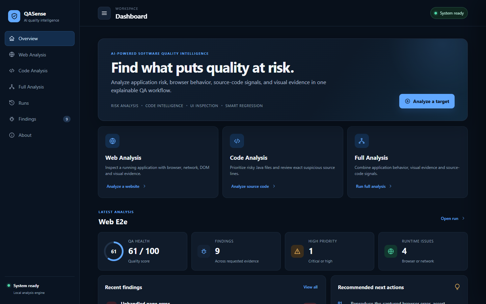
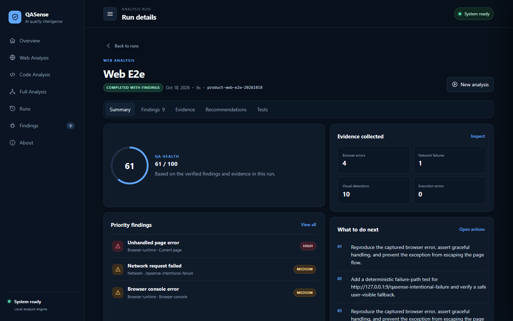
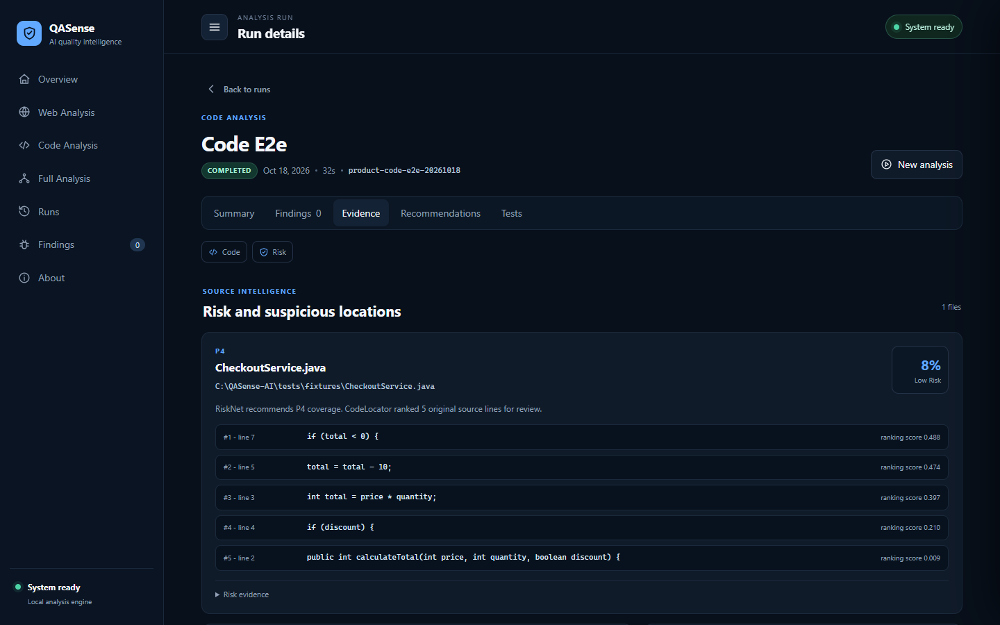
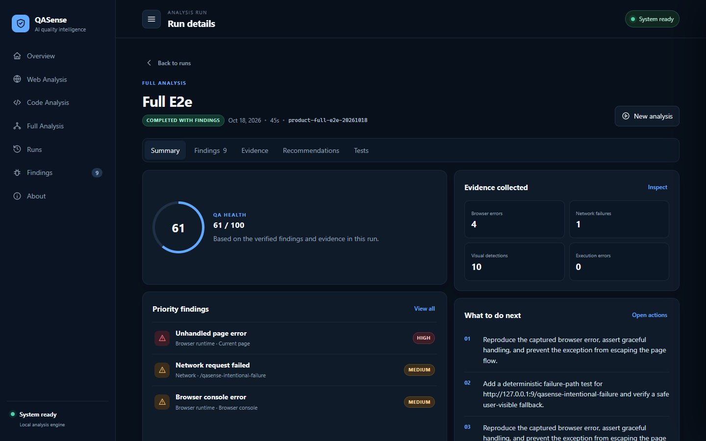
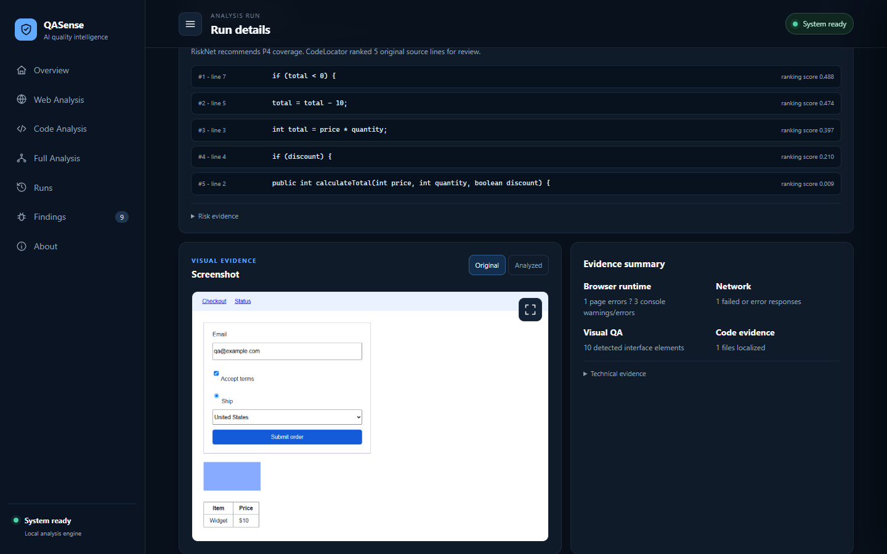
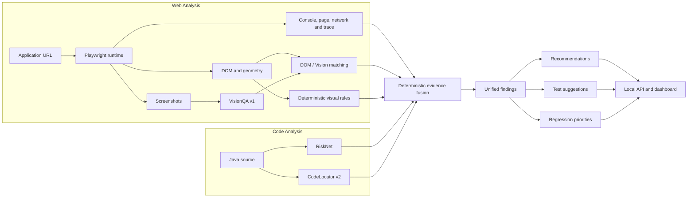

# QASense AI

QASense AI is a multimodal AI-assisted software quality analysis platform. It combines source-code risk prediction, transformer-based defect localization, computer vision, browser runtime analysis, deterministic evidence fusion, QA recommendations, test suggestions, and regression prioritization in one traceable workflow.



## What QASense does

QASense answers four practical QA questions:

- **What puts quality at risk?** RiskNet prioritizes Java source files using defect-risk evidence.
- **Where should an engineer investigate?** CodeLocator v2 ranks suspicious original source lines and preserves exact line references.
- **What failed in the running application?** Playwright records browser, network, DOM, error, trace, and screenshot evidence; VisionQA identifies visible UI elements.
- **What should QA do next?** Deterministic fusion produces explainable findings, recommendations, test suggestions, and regression priorities.

Every important finding retains links to its originating evidence. Missing modalities stay explicitly unavailable; QASense does not invent a relationship between unrelated signals.

## Analysis workflows

### Web Analysis

Web Analysis accepts a reachable URL. Playwright captures the page, DOM geometry, console messages, page exceptions, failed requests, HTTP error responses, and a trace. Production VisionQA v1 analyzes the viewport screenshot, the DOM/visual matcher compares compatible elements, and conservative visual rules add structured evidence. The result contains QA findings, recommendations, test suggestions, and regression priorities.



### Code Analysis

Code Analysis accepts a local Java file or directory. A deterministic source scanner extracts RiskNet's 21-feature runtime contract and analyzes up to 20 source files by default. RiskNet ranks file risk; CodeLocator v2 returns the original line number, source snippet, rank, and ranking score for likely fault locations.

CodeLocator scores express relative suspiciousness within the analyzed source. They are **not calibrated defect probabilities**. Runtime RiskNet features are deterministic lexical estimates aligned to the saved model contract; they are distinct from the original CK research extraction and are disclosed in each result.



### Full Analysis

Full Analysis accepts both a URL and the corresponding local Java source. The web and source pipelines run independently, then deterministic fusion combines only relationships supported by the evidence. The output preserves provenance across runtime, network, DOM, visual, risk, and source-line signals.



The Evidence view keeps the source, screenshot, browser, network, VisionQA, and DOM records available for inspection.



## Architecture



- **Web:** `URL -> Playwright -> DOM/runtime/screenshots -> VisionQA -> visual analysis -> fusion -> findings`
- **Code:** `Java source -> RiskNet -> risky files -> CodeLocator -> suspicious lines -> findings`
- **Full:** `web evidence + source evidence -> deterministic fusion -> recommendations -> tests -> regression priorities`

See [the architecture guide](docs/ARCHITECTURE.md) for contracts, process isolation, confidence semantics, failure behavior, and module responsibilities.

## Core modules

### RiskNet

RiskNet is a calibrated classical machine-learning pipeline trained on NASA PROMISE/MDP software metrics. It performs file/module defect-risk prediction and QA prioritization. The selected artifact is `models/risknet/risknet_v1.joblib`.

The model is a 21-feature logistic regression with median imputation, standard scaling, and sigmoid calibration. It contains 21 logistic coefficients, one intercept, and two calibration parameters. Current application source metrics are deterministic lexical estimates for the expected feature contract; they are not the original CK research extractor and should be interpreted as prioritization evidence.

Verified cross-project results: precision 0.354, recall 0.446, F1 0.379, ROC-AUC 0.754, PR-AUC 0.364, and MCC 0.285.

### CodeLocator v2

CodeLocator v2 is a CodeBERT-style transformer implemented as `RobertaForSequenceClassification`. It ranks suspicious Java source lines using natural source context and preserves one-based original line references. The runtime artifact is `models/codelocator_v2/line_localizer/model.safetensors` with its local configuration and tokenizer.

Verified held-out results are MRR 0.53716, Top-1 35.597%, Top-3 64.637%, and Top-5 77.986%. Its 124,647,170 parameters were counted from the loaded local model. Ranking scores prioritize investigation; they do not represent calibrated defect probability.

### VisionQA v1

VisionQA v1 is the production/rollback YOLO11n UI-element detector at `models/visionqa/atomblock_yolo11n/best.pt`. It was trained on the prepared AtomBlock-WebUI detection data and outputs 14 classes:

`button`, `link`, `input`, `image`, `icon`, `checkbox`, `radio`, `select`, `block-nav`, `block-sidebar`, `block-footer`, `block-form`, `block-table`, and `block`.

The loaded model has exactly 2,608,042 parameters. Held-out AtomBlock results are precision 0.47383, recall 0.40132, mAP50 0.37755, and mAP50-95 0.27825. Performance is materially weaker for radio, checkbox, icon, select, form, and table classes.

### VisionQA v2 — experimental

VisionQA v2 remains an experimental 14-class candidate at `models/visionqa/visionqa_v2_mixed14/candidate.pt`. It adapted v1 with curated WebUI data plus full AtomBlock rehearsal and source-aware partial-label loss. It also has exactly 2,608,042 parameters.

At the preselected global threshold 0.0625, the untouched 399-screen WebUI confirmation produced precision 0.11309, recall 0.05906, F1 0.07759, and macro-F1 0.10102. It was not promoted because select detection remained unresolved, tiny/mobile recall was weak, gains were concentrated by source, and the lower threshold increased false-positive volume. Production requests continue to use v1 at confidence 0.25.

### Playwright runtime

Playwright is the runtime evidence collector, not an AI model. It captures viewport and full-page screenshots, DOM structure and geometry, console output, page errors, failed requests, HTTP error responses, timing metadata, and a browser trace.

### DOM ↔ Vision matching

QASense compares VisionQA detections with DOM elements using geometry and semantic compatibility. IoU, containment, center distance, and role/class compatibility provide match evidence and surface semantic conflicts without assuming every visual box maps perfectly to one DOM node.

### Visual defect layer

The runtime visual layer uses conservative deterministic geometry and DOM checks. VisionQA identifies interface elements; it does not directly learn every visual defect. The separate controlled synthetic benchmark validates its generated fixture mutations and does not establish real-world defect accuracy.

### Multimodal fusion

Fusion v1 is deterministic. It normalizes evidence, applies documented severity and confidence rules, groups concrete duplicate entities, and preserves each source record. RiskNet probability, CodeLocator ranking score, and VisionQA confidence retain their different meanings.

### Recommendations, tests, and regression priorities

Findings drive evidence-specific QA recommendations and structured test suggestions. Runnable Playwright skeletons are emitted only when selectors and behavior are sufficiently concrete. Regression priorities use deterministic severity and evidence support to assign P0–P3 coverage order.

## Model summary

| Component | Approach | Role | Verified parameters / structure | Status |
|---|---|---|---:|---|
| RiskNet | Calibrated logistic pipeline | Defect-risk prioritization | 21 coefficients + 1 intercept + 2 calibration parameters | Production |
| CodeLocator v2 | CodeBERT-style transformer | Suspicious-line ranking | 124,647,170 | Production |
| VisionQA v1 | YOLO11n | UI-element detection | 2,608,042 | Production / rollback |
| VisionQA v2 | YOLO11n partial-label adaptation | Cross-domain UI detection | 2,608,042 | Experimental |

The production neural path contains 127,255,212 parameters across CodeLocator v2 and VisionQA v1. All selected neural checkpoints, including experimental v2, contain 129,863,254 parameters. RiskNet is excluded from neural totals. See the [model parameter audit](reports/QASENSE_MODEL_PARAMETER_AUDIT.md) for the artifact-backed method and fitted preprocessing state.

## Datasets

| Dataset | QASense use |
|---|---|
| NASA PROMISE / MDP | RiskNet training and cross-project evaluation |
| ManySStuBs4J | CodeLocator localization data |
| AtomBlock-WebUI | VisionQA v1 training, validation, and held-out testing |
| Curated WebUI + AtomBlock rehearsal | VisionQA v2 adaptation while preserving the 14-class contract |
| Google Screen Annotation | Audited only; not used for model training because the local screenshot/provenance dependency was unresolved |

Datasets, generated runs, and research caches remain outside Git because they are large or reproducible. Fixed evaluation manifests and reports document the scientific state.

## Technology stack

- **AI/ML:** Python, PyTorch, Transformers, CodeBERT/RoBERTa, Ultralytics YOLO11n, scikit-learn, pandas, NumPy
- **QA/browser:** Playwright, Microsoft Edge, DOM inspection, browser runtime and network evidence
- **Product:** Python `ThreadingHTTPServer`, HTML, CSS, and dependency-free JavaScript
- **Engineering:** pytest, Git, GitHub, and Git LFS

## Project structure

```text
src/
  risknet/              Risk model inference and evaluation
  codelocator_v2/       Debiased transformer localization runtime
  visionqa/             YOLO inference and DOM/visual matching
  playwright_runtime/   Browser evidence collection
  visual_defects/       Deterministic visual checks
  product/              Contracts, orchestration, fusion, API, dashboard
scripts/                Reproducible startup, verification, and reporting tools
tests/                  Model, adapter, integration, and product tests
docs/                   Architecture, demo, model cards, and screenshots
models/                 Selected Git LFS inference artifacts
reports/                Verified model and project state reports
```

## Installation

The selected trained model binaries are tracked with Git LFS. Git, Git LFS, Python 3.14, Microsoft Edge, and an NVIDIA CUDA-capable environment for the verified VisionQA path are expected on Windows.

```powershell
git clone https://github.com/mujtabashah1/QASense-AI.git
cd QASense-AI
git lfs install
git lfs pull
python scripts\verify_model_assets.py
```

Create the product environment and install the browser runtime:

```powershell
py -3.14 -m venv .venv-integration
.\.venv-integration\Scripts\python.exe -m pip install -r requirements-product.txt
.\.venv-integration\Scripts\python.exe -m playwright install msedge
```

The orchestrator isolates the three model dependency sets. Create their environments at the exact paths used by the runtime:

```powershell
py -3.14 -m venv .venv-risknet
.\.venv-risknet\Scripts\python.exe -m pip install -r requirements-risknet.txt

py -3.14 -m venv .venv-codelocator
.\.venv-codelocator\Scripts\python.exe -m pip install -r requirements-codelocator.txt

py -3.14 -m venv .venv-visionqa
.\.venv-visionqa\Scripts\python.exe -m pip install -r requirements-visionqa-torch.txt --index-url https://download.pytorch.org/whl/cu126
.\.venv-visionqa\Scripts\python.exe -m pip install -r requirements-visionqa.txt
```

The exact tested environments are also preserved in the lock files. Verify `torch.cuda.is_available()` in `.venv-visionqa` before running GPU inference.

## Running QASense locally

Start the real API and dashboard from the repository root:

```powershell
.\.venv-integration\Scripts\python.exe scripts\serve_qasense.py --host 127.0.0.1 --port 8765
```

Open: **http://127.0.0.1:8765**

The dashboard exposes Web Analysis, Code Analysis, and Full Analysis. For a credential-free end-to-end fixture run:

```powershell
.\.venv-integration\Scripts\python.exe scripts\run_qasense_demo.py
```

The fixture intentionally emits a page error, console error, and failed request so the evidence flow can be inspected. It is an integration demonstration, not a production accuracy claim.

## Tests

```powershell
.\.venv-integration\Scripts\python.exe -m pytest -q tests\product tests\adapters tests\contracts tests\integration tests\visionqa\test_matching.py tests\visionqa\test_inference_contract.py tests\visual_defects\test_baseline.py
```

The repository also contains focused RiskNet, CodeLocator, VisionQA research, corpus-integrity, threshold-analysis, and controlled visual-defect tests.

## Known limitations

- Code Analysis currently supports Java, reads at most 20 source files by default, and uses lexical runtime estimates for RiskNet's 21-feature contract.
- RiskNet predicts prioritization risk rather than defect truth; CodeLocator ranks candidate lines rather than proving the faulty line.
- VisionQA detects UI elements rather than directly classifying all visual defects. V1 has weak rare/small classes and limited cross-domain transfer.
- VisionQA v2 remains experimental due to select, tiny-object, mobile, source-concentration, and false-positive limitations.
- Real sites may need authentication, stable test data, consent handling, application-specific waits, and safe test environments.
- Controlled synthetic visual-defect results are regression evidence for their fixture, not real-world accuracy.
- The first fusion layer is deterministic and explainable; it is not a trained multimodal neural model.

## Documentation

- [Architecture](docs/ARCHITECTURE.md)
- [Local demo](docs/DEMO.md)
- [RiskNet model card](docs/models/RISKNET.md)
- [CodeLocator v2 model card](docs/models/CODELOCATOR_V2.md)
- [VisionQA v1 model card](docs/models/VISIONQA_V1.md)
- [VisionQA v2 experimental model card](docs/models/VISIONQA_V2.md)
- [Canonical project state](reports/QASENSE_PROJECT_STATE.md)
- [Final product report](reports/QASENSE_FINAL_PRODUCT_REPORT.md)
- [Migration manifest](reports/QASENSE_MIGRATION_MANIFEST.md)

## License

MIT. See [LICENSE](LICENSE).
