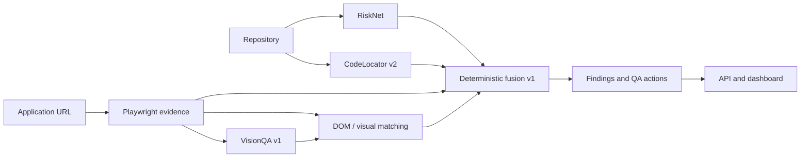

# QASense AI

QASense AI is a portfolio-grade software quality platform that combines source-code risk, bug localization, browser runtime evidence, screenshot understanding, deterministic visual checks, and traceable QA decisions. It turns the project's completed ML models into one reproducible analysis run instead of presenting them as disconnected experiments.

## What it does

- **RiskNet** ranks files by defect risk and QA priority.
- **CodeLocator v2** ranks suspicious Java source lines.
- **Playwright runtime** captures screenshots, DOM geometry, console output, page errors, failed requests, HTTP errors, timing, and a trace.
- **VisionQA v1** detects 14 UI element classes on screenshots and matches them to DOM elements.
- **Deterministic fusion v1** creates evidence-backed findings, severity, confidence, recommendations, test suggestions, and regression priorities.
- **Local API and dashboard** expose completed runs and their original/annotated evidence.



## Verified model status

| Model | Status | Selected result | Artifact |
|---|---|---|---|
| RiskNet | Production / protected | F1 0.379, ROC-AUC 0.754, PR-AUC 0.364 | `models/risknet/risknet_v1.joblib` |
| CodeLocator v2 | Production / protected | Top-1 35.60%, Top-5 77.99%, MRR 0.5372 | `models/codelocator_v2/line_localizer` |
| VisionQA v1 | Production / rollback | AtomBlock mAP50 0.37755, mAP50-95 0.27825 | `models/visionqa/atomblock_yolo11n/best.pt` |
| VisionQA v2 | Experimental | Frozen WebUI F1 0.07759 at preselected threshold 0.0625 | `models/visionqa/visionqa_v2_mixed14/candidate.pt` |

VisionQA v2 is not promoted. Its unresolved limits include select detection, tiny objects, mobile recall, source sensitivity, and greater false-positive volume. The controlled synthetic visual-defect benchmark is regression evidence for its fixture only; it is not real-world accuracy.

## Quick start

### Clone with trained models

Git and Git LFS are required. The selected production models and the experimental VisionQA v2 candidate are stored as LFS objects.

```powershell
git clone https://github.com/mujtabashah1/QASense-AI.git
cd QASense-AI
git lfs install
git lfs pull
python scripts\verify_model_assets.py
```

The verification command checks all four model hashes and the CodeLocator tokenizer/configuration files. It does not train or modify a model. Datasets and generated runs are intentionally excluded because normal product inference does not require them.

Windows with Python 3.14 and Microsoft Edge:

```powershell
py -3.14 -m venv .venv-integration
.\.venv-integration\Scripts\python.exe -m pip install -r requirements-product.txt
.\.venv-integration\Scripts\python.exe -m playwright install msedge
```

Restore the protected model artifacts listed in [the migration manifest](reports/QASENSE_MIGRATION_MANIFEST.md), then create the model-specific environments from `requirements-risknet.txt`, `requirements-codelocator.txt`, `requirements-visionqa-torch.txt`, and `requirements-visionqa.txt`.

Run the deterministic local demo:

```powershell
.\.venv-integration\Scripts\python.exe scripts\run_qasense_demo.py
```

Launch the API and dashboard:

```powershell
.\.venv-integration\Scripts\python.exe scripts\serve_qasense.py
# Open http://127.0.0.1:8765
```

Run product tests:

```powershell
.\.venv-integration\Scripts\python.exe -m pytest -q tests\product tests\adapters tests\contracts tests\integration tests\visionqa\test_matching.py tests\visionqa\test_inference_contract.py tests\visual_defects\test_baseline.py
```

## API

- `POST /api/runs` starts an analysis.
- `GET /api/runs` lists runs.
- `GET /api/runs/{id}` returns the complete evidence contract.
- `GET /api/runs/{id}/findings`, `/evidence`, `/recommendations`, `/tests`, and `/regression` return focused views.
- `GET /api/runs/{id}/artifact/{key}` serves a linked local artifact safely.
- `GET /api/models/status` reports production/experimental status and expected hashes.

The API returns partial results when a model or source modality is unavailable. It never treats a missing modality as evidence that a defect exists.

## Documentation

- [Architecture](docs/ARCHITECTURE.md)
- [Demo and setup](docs/DEMO.md)
- [RiskNet model card](docs/models/RISKNET.md)
- [CodeLocator v2 model card](docs/models/CODELOCATOR_V2.md)
- [VisionQA v1 model card](docs/models/VISIONQA_V1.md)
- [VisionQA v2 model card](docs/models/VISIONQA_V2.md)
- [Final product report](reports/QASENSE_FINAL_PRODUCT_REPORT.md)

## Known limitations and roadmap

The demo fixture proves end-to-end integration, not production-site accuracy. Real sites may require authentication, stable test data, consent handling, and application-specific waits. RiskNet predicts file risk rather than defect truth; CodeLocator ranks candidate lines; VisionQA detects UI elements rather than defects. Single-state visual rules are conservative, while the pairwise controlled benchmark remains synthetic.

Deferred research includes select detection, tiny/mobile VisionQA improvement, v2 promotion research, a real-world visual-defect dataset/model, and learned multimodal fusion. These are intentionally outside the product-completion milestone.

## License

MIT. See [LICENSE](LICENSE).
