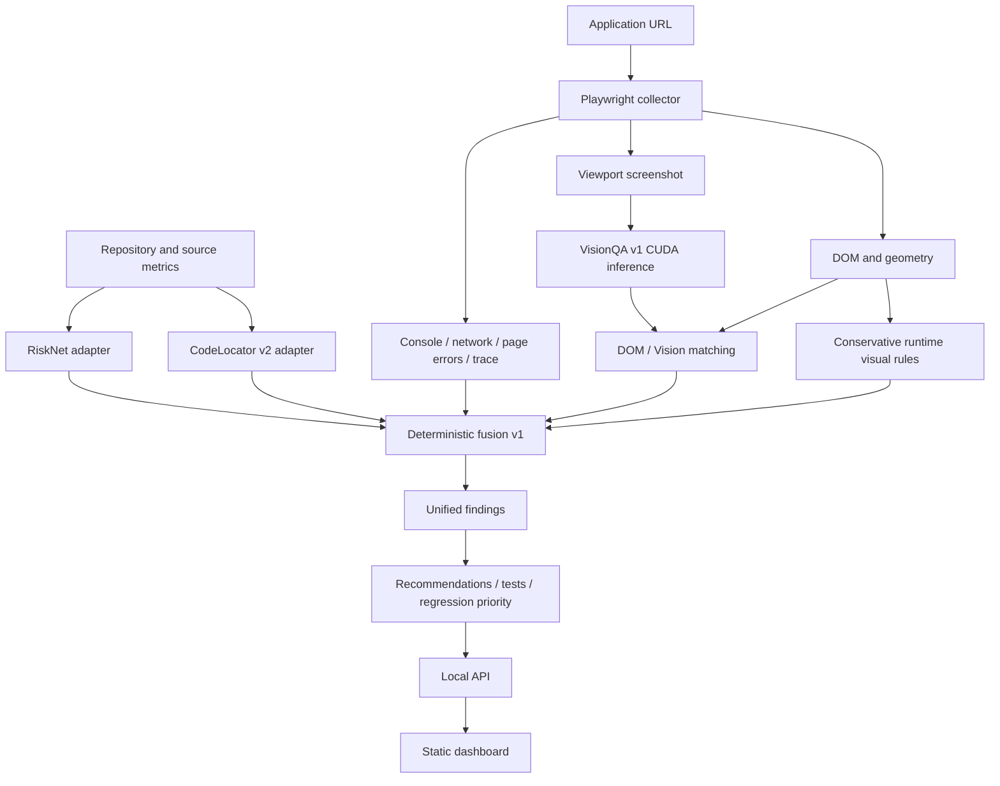

# QASense AI architecture

## Runtime flow

## Responsibilities

- `src/adapters`: read-only model normalization. Adapters never save or train models.
- `src/playwright_runtime`: browser evidence and DOM extraction.
- `src/visionqa`: production inference and semantic/geometry matching.
- `src/visual_defects`: controlled pairwise baseline plus conservative single-state checks.
- `src/product/contracts.py`: canonical JSON-serializable run contract, schema version `1.0`.
- `src/product/fusion.py`: deterministic finding association, severity, confidence support, deduplication, recommendations, tests, and regression priority.
- `src/product/orchestrator.py`: cross-environment execution and partial-result recovery.
- `src/product/source_analysis.py`: safe Java discovery and deterministic 21-feature RiskNet runtime extraction.
- `src/product/api.py`: local asynchronous run API and safe artifact serving.
- `src/product/dashboard`: dependency-free run browser and evidence view.

## Evidence contract

The canonical schema is `src/product/evidence.schema.json`. Every finding includes its source evidence. Missing modalities carry `status: unavailable`; the fusion engine does not synthesize absent evidence.

Severity uses explicit rules. Page crashes and HTTP 5xx are high/critical depending on impact; failed requests and console errors are medium; visual obstruction uses the rule severity; file risk and line suspiciousness produce code-risk findings only after evidence thresholds are met.

RiskNet probability, CodeLocator suspiciousness, and VisionQA confidence retain their original meanings. For a combined code-risk finding, QASense computes a conservative evidence-support score using `0.6 × max(score) + 0.4 × min(score)` when both are present. It is not described as a calibrated joint probability. Independent duplicate evidence combines with `1 - product(1 - confidence)`, capped per item at 0.95.

Deduplication keys findings by category and concrete entity: file, endpoint, selector, console message, or page error. Original evidence records remain attached to the resulting finding.

Regression priority uses `severity_weight × 70 + confidence × 30`, capped at 100: P0 ≥ 90, P1 ≥ 70, P2 ≥ 45, otherwise P3.

The dashboard QA score starts at 100 and subtracts `severity_weight × confidence × 12` per finding, floored at zero. It is a transparent run summary, not a learned quality probability.

## Process isolation

The integration process uses `.venv-integration`. RiskNet, CodeLocator, and VisionQA run in their validated environments through `scripts/product_model_inference.py` and `scripts/visionqa_inference.py`. This avoids dependency conflicts and preserves the model environments used for evaluation.

`scripts/product_model_inference.py` supports batch inputs, so each Code Analysis loads RiskNet and CodeLocator once rather than once per file. CodeLocator receives unchanged source files and returns one-based original line references. The product source scanner currently supports Java, matching the validated CodeLocator domain.

RiskNet's product extractor emits the saved 21-feature schema in the trained order. Its lexical Halstead and complexity values are deterministic runtime estimates; the product records this limitation because they are not outputs from the original CK research extractor.

## Model locations

- RiskNet: `models/risknet/risknet_v1.joblib`
- CodeLocator v2: `models/codelocator_v2/line_localizer`
- VisionQA production: `models/visionqa/atomblock_yolo11n/best.pt`
- VisionQA experimental: `models/visionqa/visionqa_v2_mixed14/candidate.pt`

The production pipeline always defaults to VisionQA v1 at confidence 0.25. V2 appears in model status only.

## Failure behavior

Collector or model failures are appended to the run's `errors` array. Available modalities still reach fusion, and the run becomes `partial`. A missing screenshot prevents VisionQA but does not discard RiskNet/CodeLocator evidence. A missing source file prevents code evidence but does not block browser analysis.
